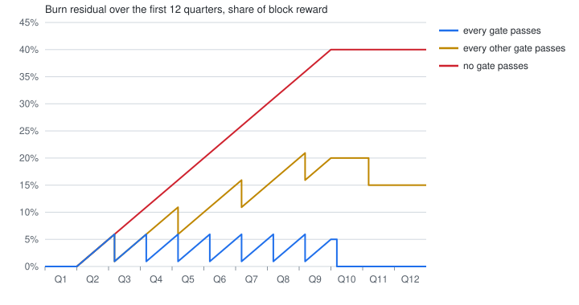

# swa-autostreams

Design study for [Filecoin R&D RFP 5: Automatic New Streams in the SWA](https://www.filpgf.io/rnd/#rfp-5).

Since the Solstice upgrade ([FIP-0118](https://github.com/filecoin-project/FIPs/blob/master/FIPS/fip-0118.md), live on mainnet from 19 October 2026) the block reward is split into streams. The Stream Weights Actor (SWA) can register a new stream in the reward actor (f02), but by convention each one needs its own accepted FIP. The RFP asks for a protocol that lets the SWA open streams and set their weights from an on-chain signal instead.

This repo holds the groundwork: a model of the rules f02 enforces, a first analysis of how much room there is for new streams, and the design notes that follow from both.

## Main result so far

New streams can only take weight from the burn share, `w0 = 1 - w1 - w2`. How big that share is depends on how the service stream's volume gate goes.



| Scenario | Residual in Q4 | Q8 | Q12 |
|---|---|---|---|
| Every volume gate passes | 0.9% to 5.9% | 0.9% to 5.9% | 0% |
| Every other gate passes | 5% to 10% | 15% to 20% | 15% |
| No gate passes | 10% to 15% | 30% to 35% | 40% |

So the room for new streams is the service demand that has not shown up yet. If Filecoin Pay volume clears every gate there is almost nothing to hand out, and if it clears none, 40% of issuance ends up burned. At roughly 20M FIL of issuance a year, one point of weight is about 200,000 FIL a year.

Two things follow for any automatic mechanism:

1. It has to give way to the service stream. FIP-0118 says a new stream that takes part of `1 - w1` makes the next gate write fail (section 3.1.1). [`tests/test_fip0118.py`](tests/test_fip0118.py) reproduces that case.
2. It has to say how much of the burn may be redirected. That is a policy choice, and the design treats it as a governed parameter.

Details are in [docs/budget.md](docs/budget.md).

## What is in the repo

| Path | What it is |
|---|---|
| [`autostreams/weights.py`](autostreams/weights.py) | Weight records and the schedule check f02 runs on every SWA write (FIP-0118 sections 2.4.1 and 2.4.8) |
| [`autostreams/fip0118.py`](autostreams/fip0118.py) | Mainnet parameters, the w1 ramp and the w2 volume gate |
| [`autostreams/headroom.py`](autostreams/headroom.py) | The residual analysis above |
| [`tests/`](tests) | Unit tests, plus a randomized test that compares the breakpoint check with checking every epoch |
| [`docs/`](docs) | Design notes, listed below |
| [`results/`](results) | Output of the headroom run (CSV and chart) |

Design notes:

- [constraints.md](docs/constraints.md): what f02 enforces and what it leaves to the SWA
- [budget.md](docs/budget.md): the burn residual and the priority rule for w2
- [write-path.md](docs/write-path.md): how automatic weight changes fit the timelock and queue rules
- [mechanisms.md](docs/mechanisms.md): the candidate designs to compare
- [threats.md](docs/threats.md): the attacks the analysis has to cover
- [bittensor.md](docs/bittensor.md): what carries over from dTAO and Taoflow, and what does not
- [plan.md](docs/plan.md): what gets built next and how it will be checked

## Running it

Python 3.10 or newer. The model has no dependencies; the tests need pytest.

```bash
python -m autostreams.headroom results
```

```bash
pip install pytest && python -m pytest -q
```

## Status

Early. The constraint model and the budget analysis are done. The simulation, the reference SWA contract and the spec are not started. Open questions are listed at the end of each note in `docs/`.

Nothing here is deployed anywhere, and nothing here is an accepted FIP.

## Licence

MIT. See [LICENSE](LICENSE).
